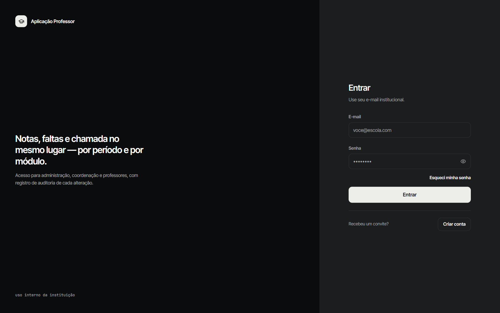
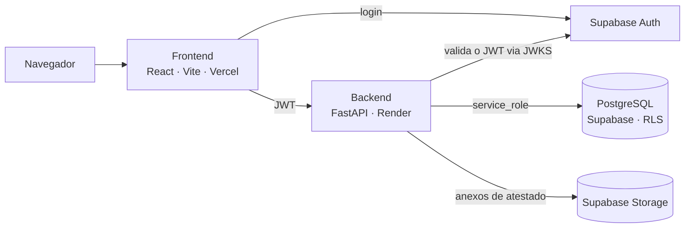

<h1 align="center">Aplicação Professor — Portal</h1>

<p align="center">
  Sistema acadêmico para gestão de alunos, módulos, notas e faltas, com três perfis de acesso: <b>admin</b>, <b>coordenador</b> e <b>professor</b>.
</p>

<p align="center">
  <a href="https://github.com/P4d1lh4/Portal-Professor/actions/workflows/ci.yml"></a>
  <a href="https://portalprofessor.vercel.app"></a>
</p>

<p align="center">
  
  
  
  
  
  
  
  
  
</p>

<p align="center">
  <a href="#visão-geral">Visão geral</a> ·
  <a href="#funcionalidades-por-papel">Funcionalidades</a> ·
  <a href="#stack">Stack</a> ·
  <a href="#como-rodar">Como rodar</a> ·
  <a href="#api">API</a> ·
  <a href="#testes-e-ci">Testes</a> ·
  <a href="#segurança">Segurança</a> ·
  <a href="#documentação">Documentação</a>
</p>

<p align="center">
  <a href="https://portalprofessor.vercel.app"></a>
</p>

## Visão geral

O portal reúne notas, faltas e chamada no mesmo lugar, por período e por módulo, com registro de auditoria de cada alteração.

> Recriação moderna do sistema original (Flask + SQLite + Bootstrap 5) usando React + FastAPI + Supabase.



O que o projeto tem de particular:

- **Autorização na API, testada por papel.** Papel e escopo (professor só nos seus módulos, coordenador só nos seus períodos) são checados no FastAPI. O RLS do banco fica como defesa em profundidade. A decisão está na [ADR 0001](docs/adr/0001-autorizacao-na-aplicacao.md).
- **Auditoria.** As mutações relevantes vão para `audit_log`, com uma tela própria para o admin.
- **Cadastro só por convite.** Conta nova nasce pelo admin ou por um convite de uso único com validade de 7 dias.
- **CI que cobre o banco.** Além dos testes, o CI builda a imagem do backend e aplica todas as migrações num Postgres, com checks de comportamento do schema.
- **Histórico de mudanças.** Cada alteração relevante tem um registro em [`docs/alteracoes/`](docs/alteracoes/INDEX.md).

## Funcionalidades por papel

| Funcionalidade | Admin | Coordenador | Professor |
|----------------|:-----:|:-----------:|:---------:|
| Ver dashboard com métricas | ✓ | ✓ | ✓ |
| Gerenciar usuários | ✓ | — | — |
| Gerar convite de cadastro (uso único, 7 dias) | ✓ (coordenador ou professor) | ✓ (professor) | — |
| CRUD de períodos acadêmicos | ✓ | — | — |
| Ver/editar módulos do período | ✓ | ✓ | — |
| Ver módulos próprios | — | — | ✓ |
| Cadastrar e gerenciar alunos | ✓ | ✓ | ✓* |
| Lançar notas e faltas (inline) | ✓ | ✓ | ✓ |
| Registrar frequência/chamada por data | ✓ | ✓ | ✓ |
| Gerenciar atestados médicos (anexos PDF) | ✓ | ✓ | ✓* |
| Gerar relatórios/boletins em PDF | ✓ | ✓ | ✓ |
| Exportar dados em CSV | ✓ | ✓ | ✓ |
| Importar alunos via CSV | ✓ | ✓ | — |
| Sincronizar com Google Sheets | ✓ | ✓ | — |
| Ver log de auditoria | ✓ | — | — |

*Professor cria alunos com auto-matrícula nos seus módulos ativos e acessa apenas dados dos próprios módulos.

## Stack

| Camada | Tecnologias |
|--------|-------------|
| **Frontend** | React 19 · TypeScript · Vite · TailwindCSS · shadcn/ui (Radix) · TanStack Query v5 · React Hook Form + Zod · Zustand |
| **Backend** | FastAPI 0.141 · Pydantic v2 · supabase-py · ReportLab (PDF) · JWT via JWKS (RS256/ES256; HS256 legado) |
| **Banco** | Supabase (PostgreSQL) · Supabase Auth · Row Level Security |
| **Testes** | pytest (backend) · vitest + Testing Library (frontend) · cobertura mínima de 70% no backend, exigida pelo CI |
| **Infra** | Vercel (frontend) · Render (backend) · Docker · GitHub Actions (CI, backup semanal, keep-alive) |

## Como rodar

### Pré-requisitos

- Node.js 20+ (o CI usa 24)
- Python 3.11+ (CI e produção usam 3.13)
- Conta no [Supabase](https://supabase.com) (plano gratuito é suficiente)
- Docker (opcional)

### 1. Clonar e instalar dependências

```bash
git clone https://github.com/P4d1lh4/Portal-Professor.git
cd Portal-Professor

# Frontend
cd frontend && npm install && cd ..

# Backend
cd backend && pip install -r requirements.txt && cd ..
```

### 2. Variáveis de ambiente

**`frontend/.env`**
```env
VITE_SUPABASE_URL=https://<project>.supabase.co
VITE_SUPABASE_ANON_KEY=<anon_key>
VITE_API_BASE_URL=http://localhost:8000
```

**`backend/.env`**
```env
SUPABASE_URL=https://<project>.supabase.co
SUPABASE_ANON_KEY=<anon_key>
SUPABASE_SERVICE_ROLE_KEY=<service_role_key>   # nunca expor no frontend
SUPABASE_JWT_SECRET=<jwt_secret>               # Settings → API → JWT Secret
CORS_ORIGINS=http://localhost:5173
```

### 3. Aplicar migrations

No **SQL Editor** do Supabase, **aplique TODOS os arquivos de `supabase/migrations/` em ordem numérica** (0001 → 0014). Não pare em nenhum número intermediário: o backend depende dos objetos criados ao longo delas (ex.: a RPC `save_attendance_day` da `0010`; sem ela, salvar frequência quebra em runtime).

<details>
<summary><b>O que cada migration faz</b></summary>

<br/>

| Migration | Conteúdo |
|---|---|
| `0001_initial_schema.sql` | Schema inicial. |
| `0002_rls_granular.sql` | Remove as policies temporárias e ativa as policies granulares por papel. |
| `0003_medical_certificates.sql` | Atestados médicos. |
| `0004_profile_is_active.sql` | `is_active` no perfil. |
| `0005_attendance_records.sql` | Registro de faltas. |
| `0006_audit_log.sql` | Log de auditoria. |
| `0007_create_student_with_enrollments.sql` | RPC transacional de criação de aluno com matrículas. |
| `0008_grade_check_constraints.sql` | CHECK constraints das notas. |
| `0009_search_indexes.sql` | Índices de busca. |
| `0010_save_attendance_day_rpc.sql` | RPC `save_attendance_day`. |
| `0011_lock_postgrest_writes.sql` | Revoga a escrita direta via PostgREST de `anon`/`authenticated` (fecha a escalada de privilégio a admin). |
| `0012_hardening.sql` | Endurece o banco: `profiles` legível só pelo dono (ou admin), CHECK de datas do período, alunos/módulos sem cascata ao apagar período, e-mail único, trigger contra troca de papel por não-admin e `search_path` fixo nas funções `SECURITY DEFINER`. |
| `0013_housekeeping.sql` | Cria a tabela de controle `schema_migrations` e o trigger que atualiza `grades.last_updated`. |
| `0014_invite_codes.sql` | Convites de cadastro; o trigger `handle_new_user` passa a ignorar o papel mandado pelo cliente. |

</details>

A tabela `schema_migrations` é a mesma que o `backend/scripts/apply_migration.py` usa. Aplicando pelo SQL Editor, registre depois com `--mark-applied`.

### 4. Seed de dados de exemplo

```bash
# Definir senhas no .env do backend (obrigatórias; o seed falha sem elas)
SEED_ADMIN_PASSWORD=<senha-forte>
SEED_DEFAULT_PASSWORD=<senha-forte>

python backend/scripts/seed.py
```

Cria: 1 admin + 2 coordenadores + 4 professores + 2 períodos + 8 módulos + 20 alunos com notas realistas.

Contas de exemplo após o seed:

| Papel        | Email                  | Senha             |
|--------------|------------------------|-------------------|
| Admin        | admin@escola.com       | `SEED_ADMIN_PASSWORD` |
| Coordenador  | coord1@escola.com      | `SEED_DEFAULT_PASSWORD` |
| Coordenador  | coord2@escola.com      | `SEED_DEFAULT_PASSWORD` |
| Professor    | prof1@escola.com       | `SEED_DEFAULT_PASSWORD` |
| Professor    | prof2@escola.com       | `SEED_DEFAULT_PASSWORD` |

### 5. Rodar localmente

**Com Docker Compose:**
```bash
docker-compose up
```

**Ou separadamente:**
```bash
# Backend (porta 8000)
cd backend && uvicorn app.main:app --reload

# Frontend (porta 5173)
cd frontend && npm run dev
```

Para publicar em produção (Vercel + Render + Supabase), siga o [DEPLOY.md](DEPLOY.md).

## API

Documentação interativa:

- Swagger UI: `http://localhost:8000/api/docs`
- ReDoc: `http://localhost:8000/api/redoc`

A lista completa e sempre atualizada de endpoints está no Swagger.

<details>
<summary><b>Endpoints principais</b></summary>

```
GET    /api/healthz
GET    /api/readyz
GET    /api/me

POST   /api/invites           (admin, coordenador)
POST   /api/signup/check      (público: confere o código do convite)
POST   /api/signup            (público: cria a conta com o convite)
GET    /api/dashboard?period_id=

GET    /api/periods
POST   /api/periods
PUT    /api/periods/{id}
DELETE /api/periods/{id}
PUT    /api/periods/{id}/sync-url
POST   /api/periods/{id}/sync-sheets
POST   /api/periods/{id}/students/import?dry_run=true|false

GET    /api/modules
POST   /api/modules
GET    /api/modules/{id}/students
PUT    /api/modules/{id}
DELETE /api/modules/{id}

GET    /api/periods/{id}/students
POST   /api/periods/{id}/students
GET    /api/professor/students
POST   /api/professor/students
PUT    /api/professor/students/{id}
DELETE /api/professor/students/{id}

GET    /api/grades/{enrollment_id}
PUT    /api/grades/{enrollment_id}
```

</details>

## Testes e CI

```bash
cd backend && pytest          # backend (o CI exige 70% de cobertura)
cd frontend && npm run test   # frontend (vitest + Testing Library)
```

O CI tem quatro jobs:

| Job | O que faz |
|---|---|
| Backend (pytest) | Testes com cobertura mínima de 70% e auditoria de dependências (`pip-audit`). |
| Backend (docker build) | Builda a imagem e faz um smoke test (`healthz` e usuário non-root). |
| Migrações (Postgres) | Aplica todas as migrações num Postgres e roda os checks de `supabase/ci/checks.sql`. |
| Frontend | `npm audit`, lint, type-check, testes e build. |

Os testes cobrem, entre outros:

- Autorização por papel em todos os routers (isolamento de dados; escopo de coordenador/professor)
- Nota final, situação e alunos em risco (regra única, travada entre backend e frontend)
- Validators Pydantic (clamp, arredondamento)
- Parser CSV (BOM, cabeçalho do export, Latin-1, colunas obrigatórias) e neutralização de fórmula no export
- Autenticação (sem token ou token inválido/expirado → 401), SSRF e injeção de filtro PostgREST
- Telas de Notas e Chamada (salvar, rollback, rascunho não salvo) e interceptors de sessão

Como escrever testes e registrar alterações: [CONTRIBUTING.md](CONTRIBUTING.md).

## Segurança

- JWT validado server-side em cada request via JWKS do Supabase (RS256/ES256; HS256 legado)
- `SUPABASE_SERVICE_ROLE_KEY` usado **apenas** no backend (nunca exposto ao frontend)
- **A autorização é da API:** o backend usa a service_role, que ignora RLS. Papel e escopo (professor só nos seus módulos, coordenador só nos seus períodos) são checados no FastAPI e testados por papel. Ver [ADR 0001](docs/adr/0001-autorizacao-na-aplicacao.md).
- RLS nas tabelas como defesa em profundidade para acesso direto com a anon key; desde a `0011`, `anon`/`authenticated` não têm GRANT de escrita
- Conta nova só pelo backend: o admin cria, ou a pessoa se cadastra com um convite de uso único (`/api/signup`, a exceção descrita na ADR 0001). O cadastro público do Supabase Auth fica desligado (DEPLOY.md, Passo 5), e desde a `0014` o trigger `handle_new_user` ignora o papel mandado pelo cliente
- Mutações relevantes registradas em `audit_log` (tela de Auditoria, admin)

## Scripts de manutenção

Em `backend/scripts/`. Usam o `backend/.env` (**produção**) salvo se `DATABASE_URL`/`SUPABASE_*` vierem definidas na linha de comando.

| Script | Para quê |
|---|---|
| `apply_migration.py` | Aplica as migrações pendentes em ordem (`--all`), mostra o estado de cada uma (`--status`) e registra uma aplicada à mão pelo SQL Editor (`--mark-applied <versão>`). |
| `seed.py` | Dados de exemplo (seção Seed acima). |
| `diagnose.py` | Diagnóstico ponta a ponta: estado do banco, login de um professor de exemplo e `GET /api/modules` no backend local. Exige `SEED_DEFAULT_PASSWORD`. |
| `backup_storage.py` | Baixa e reenvia os anexos de atestado (backup e restore; ver `DEPLOY.md`). |

## Estrutura do monorepo

```
.
├── frontend/               # React + Vite
│   └── src/
│       ├── features/       # módulos de domínio (grades, students, modules…)
│       ├── components/     # ui/ + layout/ + shared/
│       ├── hooks/          # useAuth, etc.
│       └── routes/         # React Router (lazy + ProtectedRoute)
├── backend/
│   ├── app/
│   │   ├── routers/        # users, periods, modules, students, grades,
│   │   │                   # import_csv, sheets, dashboard, attendance,
│   │   │                   # medical_certificates, reports, exports, audit
│   │   ├── schemas/        # Pydantic models
│   │   ├── services/       # regras de negócio
│   │   ├── deps.py         # get_current_user, require_role
│   │   └── main.py
│   ├── scripts/            # seed, migrações, diagnóstico e backup
│   └── tests/              # suíte pytest (authz, regras, anti-injeção)
├── supabase/
│   ├── migrations/         # 0001–0014
│   └── ci/                 # stub do Supabase e checks de schema usados no CI
├── docs/                   # ADRs, registros de alteração e runbook
└── docker-compose.yml
```

## Documentação

| Documento | Conteúdo |
|---|---|
| [DEPLOY.md](DEPLOY.md) | Deploy em Vercel + Render + Supabase, backup e restore. |
| [CONTRIBUTING.md](CONTRIBUTING.md) | Fluxo de uma mudança, commits, testes e prova de mutação. |
| [ADR 0001](docs/adr/0001-autorizacao-na-aplicacao.md) | Por que a autorização fica na aplicação. |
| [docs/alteracoes/](docs/alteracoes/INDEX.md) | Registro de cada alteração feita no sistema. |

## Licença

Privado — uso interno da instituição.
